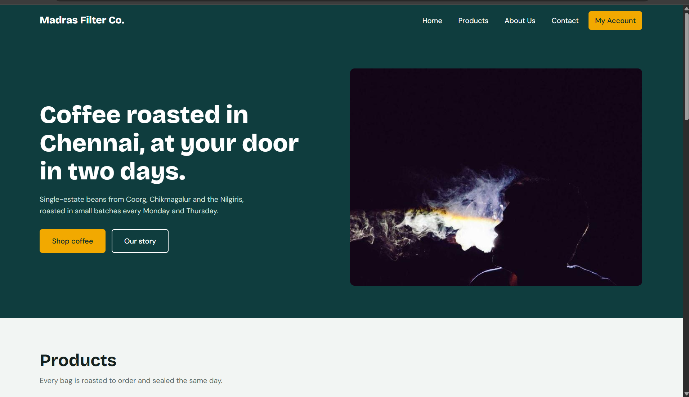
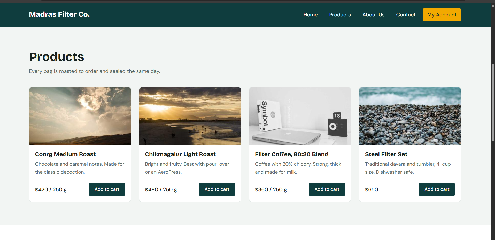
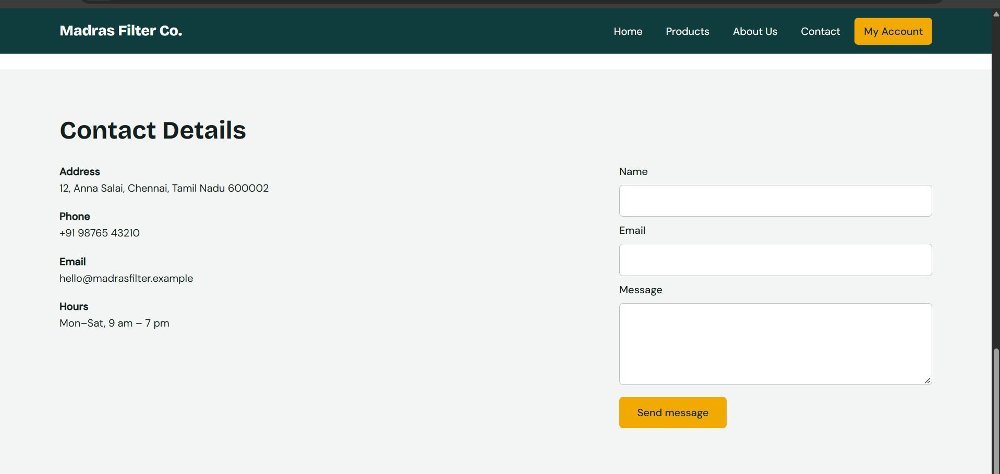
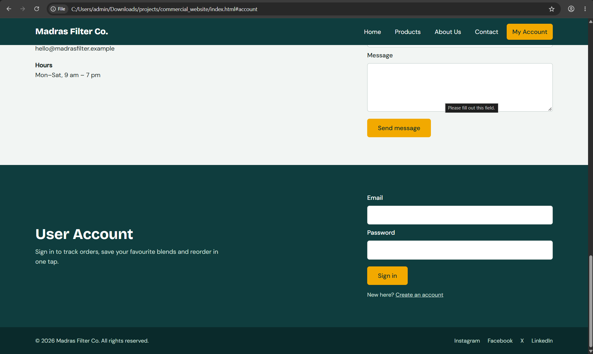

# Ex02 Commercial Website
Date: 02-11-2026

## AIM
To create a commercial website using CSS Flexbox.

## ALGORITHM

### STEP 1
Create an HTML file (index.html)

### STEP 2
Create a CSS file (style.css)

### STEP 3
Include a navigation bar with links to different sections.

### STEP 4
Add structured sections for Homepage, Products / Services, About Us, Contact Details and User Account.

### STEP 5
Include social media links at the footer with copyright information.

### STEP 6
Define global styles for fonts, colors, and layout.

### STEP 7
Style the header, navigation bar, and sections.

### STEP 8
Use Flexbox for layout design.

### STEP 9
Add hover effects and transitions for interactivity.

### STEP 10
Add Images and Media.

### STEP 11
Use optimized images for a professional look.

### STEP 12
Open the HTML file in a browser to check layout and functionality.

### STEP 13
Fix styling issues and refine content placement.

### STEP 14
Deploy the website.

### STEP 15
Upload to GitHub Pages for free hosting.

## PROGRAM

### index.html
```html
<!DOCTYPE html>
<html lang="en">
<head>
  <meta charset="UTF-8">
  <meta name="viewport" content="width=device-width, initial-scale=1">
  <title>Madras Filter Co. | Fresh-roasted South Indian coffee</title>
  <link rel="preconnect" href="https://fonts.googleapis.com">
  <link rel="preconnect" href="https://fonts.gstatic.com" crossorigin>
  <link href="https://fonts.googleapis.com/css2?family=Bricolage+Grotesque:wght@500;700;800&family=DM+Sans:wght@400;500&display=swap" rel="stylesheet">
  <link rel="stylesheet" href="style.css">
</head>
<body>

  <!-- HEADER + NAVIGATION -->
  <header class="site-header">
    <a href="#home" class="logo">Madras Filter Co.</a>
    <nav>
      <ul class="nav-links">
        <li><a href="#home">Home</a></li>
        <li><a href="#products">Products</a></li>
        <li><a href="#about">About Us</a></li>
        <li><a href="#contact">Contact</a></li>
        <li><a href="#account" class="nav-cta">My Account</a></li>
      </ul>
    </nav>
  </header>

  <main>
    <!-- HOMEPAGE -->
    <section id="home" class="hero">
      <div class="hero-text">
        <h1>Coffee roasted in Chennai, at your door in two days.</h1>
        <p>Single-estate beans from Coorg, Chikmagalur and the Nilgiris, roasted in small batches every Monday and Thursday.</p>
        <div class="hero-actions">
          <a href="#products" class="btn btn-primary">Shop coffee</a>
          <a href="#about" class="btn btn-ghost">Our story</a>
        </div>
      </div>
      <div class="hero-image">
        
      </div>
    </section>

    <!-- PRODUCTS / SERVICES -->
    <section id="products" class="section">
      <h2>Products</h2>
      <p class="section-intro">Every bag is roasted to order and sealed the same day.</p>
      <div class="cards">
        <article class="card">
          
          <div class="card-body">
            <h3>Coorg Medium Roast</h3>
            <p>Chocolate and caramel notes. Made for the classic decoction.</p>
            <div class="card-foot"><span class="price">₹420 / 250 g</span><a href="#account" class="btn btn-small">Add to cart</a></div>
          </div>
        </article>
        <article class="card">
          
          <div class="card-body">
            <h3>Chikmagalur Light Roast</h3>
            <p>Bright and fruity. Best with pour-over or an AeroPress.</p>
            <div class="card-foot"><span class="price">₹480 / 250 g</span><a href="#account" class="btn btn-small">Add to cart</a></div>
          </div>
        </article>
        <article class="card">
          
          <div class="card-body">
            <h3>Filter Coffee, 80:20 Blend</h3>
            <p>Coffee with 20% chicory. Strong, thick and made for milk.</p>
            <div class="card-foot"><span class="price">₹360 / 250 g</span><a href="#account" class="btn btn-small">Add to cart</a></div>
          </div>
        </article>
        <article class="card">
          
          <div class="card-body">
            <h3>Steel Filter Set</h3>
            <p>Traditional davara and tumbler, 4-cup size. Dishwasher safe.</p>
            <div class="card-foot"><span class="price">₹650</span><a href="#account" class="btn btn-small">Add to cart</a></div>
          </div>
        </article>
      </div>
    </section>

    <!-- ABOUT US -->
    <section id="about" class="section about">
      <div class="about-image">
        
      </div>
      <div class="about-text">
        <h2>About Us</h2>
        <p>Madras Filter Co. started in 2019 in a rented garage in Avadi, with one roaster and a simple rule: pay farmers fairly and ship coffee while it is still fresh.</p>
        <p>Today we buy directly from 14 estates and roast every order in small batches.</p>
        <ul class="stats">
          <li><strong>14</strong><span>partner estates</span></li>
          <li><strong>12,000+</strong><span>happy customers</span></li>
          <li><strong>48 hrs</strong><span>roast to doorstep</span></li>
        </ul>
      </div>
    </section>

    <!-- CONTACT DETAILS -->
    <section id="contact" class="section">
      <h2>Contact Details</h2>
      <div class="contact-wrap">
        <div class="contact-info">
          <p><strong>Address</strong><br>12, Anna Salai, Chennai, Tamil Nadu 600002</p>
          <p><strong>Phone</strong><br>+91 98765 43210</p>
          <p><strong>Email</strong><br>hello@madrasfilter.example</p>
          <p><strong>Hours</strong><br>Mon–Sat, 9 am – 7 pm</p>
        </div>
        <form class="form" onsubmit="event.preventDefault(); alert('Message sent. We will reply within one working day.');">
          <label for="c-name">Name</label>
          <input id="c-name" type="text" required>
          <label for="c-email">Email</label>
          <input id="c-email" type="email" required>
          <label for="c-msg">Message</label>
          <textarea id="c-msg" rows="4" required></textarea>
          <button type="submit" class="btn btn-primary">Send message</button>
        </form>
      </div>
    </section>

    <!-- USER ACCOUNT -->
    <section id="account" class="section account">
      <div class="account-intro">
        <h2>User Account</h2>
        <p>Sign in to track orders, save your favourite blends and reorder in one tap.</p>
      </div>
      <form class="form form-light" onsubmit="event.preventDefault(); alert('Signed in (demo).');">
        <label for="a-email">Email</label>
        <input id="a-email" type="email" required>
        <label for="a-pass">Password</label>
        <input id="a-pass" type="password" required>
        <button type="submit" class="btn btn-primary">Sign in</button>
        <p class="form-note">New here? <a href="#account">Create an account</a></p>
      </form>
    </section>
  </main>

  <!-- FOOTER -->
  <footer class="site-footer">
    <p>&copy; 2026 Madras Filter Co. All rights reserved.</p>
    <ul class="social">
      <li><a href="https://www.instagram.com" target="_blank" rel="noopener">Instagram</a></li>
      <li><a href="https://www.facebook.com" target="_blank" rel="noopener">Facebook</a></li>
      <li><a href="https://x.com" target="_blank" rel="noopener">X</a></li>
      <li><a href="https://www.linkedin.com" target="_blank" rel="noopener">LinkedIn</a></li>
    </ul>
  </footer>

</body>
</html>
```

### style.css
```css
/* ---------- Global styles ---------- */
:root {
  --green: #0f3d3e;
  --green-dark: #0a2a2b;
  --saffron: #f2a900;
  --paper: #f2f5f3;
  --white: #ffffff;
  --ink: #16211f;
  --muted: #5a6b68;
}

* { margin: 0; padding: 0; box-sizing: border-box; }

html { scroll-behavior: smooth; scroll-padding-top: 72px; }

body {
  font-family: "DM Sans", Arial, sans-serif;
  color: var(--ink);
  background: var(--paper);
  line-height: 1.6;
}

h1, h2, h3, .logo {
  font-family: "Bricolage Grotesque", Georgia, sans-serif;
  line-height: 1.15;
}

img { display: block; max-width: 100%; }
a { color: inherit; text-decoration: none; }
ul { list-style: none; }

:focus-visible { outline: 3px solid var(--saffron); outline-offset: 2px; }

/* ---------- Header and navigation (Flexbox) ---------- */
.site-header {
  position: sticky;
  top: 0;
  z-index: 10;
  display: flex;
  justify-content: space-between;
  align-items: center;
  flex-wrap: wrap;
  gap: 12px;
  padding: 14px 6%;
  background: var(--green);
  color: var(--white);
}

.logo { font-size: 1.4rem; font-weight: 800; }

.nav-links { display: flex; flex-wrap: wrap; align-items: center; gap: 8px; }

.nav-links a {
  display: block;
  padding: 8px 14px;
  border-radius: 6px;
  transition: background 0.25s, color 0.25s;
}

.nav-links a:hover { background: rgba(255, 255, 255, 0.14); }

.nav-links .nav-cta { background: var(--saffron); color: var(--green-dark); font-weight: 500; }
.nav-links .nav-cta:hover { background: #ffc233; }

/* ---------- Buttons ---------- */
.btn {
  display: inline-block;
  padding: 12px 26px;
  border-radius: 6px;
  font-weight: 500;
  border: 2px solid transparent;
  cursor: pointer;
  font-family: inherit;
  font-size: 1rem;
  transition: transform 0.2s, background 0.25s, color 0.25s;
}
.btn:hover { transform: translateY(-2px); }
.btn-primary { background: var(--saffron); color: var(--green-dark); }
.btn-primary:hover { background: #ffc233; }
.btn-ghost { border-color: var(--white); color: var(--white); }
.btn-ghost:hover { background: var(--white); color: var(--green); }
.btn-small { padding: 8px 16px; font-size: 0.9rem; background: var(--green); color: var(--white); }
.btn-small:hover { background: var(--green-dark); }

/* ---------- Home / hero ---------- */
.hero {
  display: flex;
  align-items: center;
  flex-wrap: wrap;
  gap: 40px;
  padding: 72px 6%;
  background: var(--green);
  color: var(--white);
}

.hero-text { flex: 1 1 360px; }
.hero-text h1 { font-size: clamp(2rem, 5vw, 3.4rem); font-weight: 800; margin-bottom: 18px; max-width: 16ch; }
.hero-text p { max-width: 46ch; margin-bottom: 28px; color: #cfe0dc; }
.hero-actions { display: flex; flex-wrap: wrap; gap: 14px; }

.hero-image { flex: 1 1 360px; }
.hero-image img { width: 100%; border-radius: 10px; object-fit: cover; }

/* ---------- Generic sections ---------- */
.section { padding: 72px 6%; }
.section h2 { font-size: clamp(1.7rem, 3.5vw, 2.4rem); margin-bottom: 10px; }
.section-intro { color: var(--muted); margin-bottom: 36px; }

/* ---------- Products ---------- */
.cards { display: flex; flex-wrap: wrap; gap: 24px; }

.card {
  flex: 1 1 240px;
  display: flex;
  flex-direction: column;
  background: var(--white);
  border-radius: 10px;
  overflow: hidden;
  border: 1px solid #dbe3e0;
  transition: transform 0.25s, box-shadow 0.25s;
}
.card:hover { transform: translateY(-6px); box-shadow: 0 12px 24px rgba(15, 61, 62, 0.15); }
.card img { width: 100%; height: 180px; object-fit: cover; }
.card-body { flex: 1; display: flex; flex-direction: column; gap: 8px; padding: 18px; }
.card-body h3 { font-size: 1.15rem; }
.card-body p { color: var(--muted); font-size: 0.95rem; }
.card-foot { margin-top: auto; padding-top: 12px; display: flex; justify-content: space-between; align-items: center; gap: 10px; }
.price { font-weight: 500; }

/* ---------- About ---------- */
.about { display: flex; flex-wrap: wrap; align-items: center; gap: 48px; background: var(--white); }
.about-image { flex: 1 1 320px; }
.about-image img { width: 100%; border-radius: 10px; }
.about-text { flex: 1 1 360px; }
.about-text p { margin-bottom: 14px; max-width: 56ch; }

.stats { display: flex; flex-wrap: wrap; gap: 28px; margin-top: 24px; }
.stats li { display: flex; flex-direction: column; }
.stats strong { font-family: "Bricolage Grotesque", sans-serif; font-size: 1.8rem; color: var(--green); }
.stats span { color: var(--muted); font-size: 0.9rem; }

/* ---------- Contact ---------- */
.contact-wrap { display: flex; flex-wrap: wrap; gap: 48px; margin-top: 28px; }
.contact-info { flex: 1 1 260px; display: flex; flex-direction: column; gap: 18px; }

/* ---------- Forms ---------- */
.form { flex: 1 1 340px; display: flex; flex-direction: column; gap: 8px; max-width: 480px; }
.form label { font-weight: 500; }
.form input, .form textarea {
  padding: 11px 12px;
  border: 1px solid #b9c7c3;
  border-radius: 6px;
  font: inherit;
  transition: border-color 0.2s, box-shadow 0.2s;
}
.form input:focus, .form textarea:focus {
  outline: none;
  border-color: var(--green);
  box-shadow: 0 0 0 3px rgba(242, 169, 0, 0.4);
}
.form .btn { margin-top: 10px; align-self: flex-start; }
.form-note { font-size: 0.9rem; color: var(--muted); margin-top: 6px; }
.form-note a { text-decoration: underline; }

/* ---------- User account ---------- */
.account {
  display: flex;
  flex-wrap: wrap;
  align-items: center;
  justify-content: space-between;
  gap: 40px;
  background: var(--green);
  color: var(--white);
}
.account-intro { flex: 1 1 300px; }
.account-intro p { max-width: 44ch; color: #cfe0dc; }
.form-light label { color: var(--white); }
.form-light .form-note { color: #cfe0dc; }
.form-light input { background: var(--white); color: var(--ink); }

/* ---------- Footer ---------- */
.site-footer {
  display: flex;
  justify-content: space-between;
  align-items: center;
  flex-wrap: wrap;
  gap: 14px;
  padding: 24px 6%;
  background: var(--green-dark);
  color: #cfe0dc;
  font-size: 0.9rem;
}
.social { display: flex; flex-wrap: wrap; gap: 20px; }
.social a { transition: color 0.2s; }
.social a:hover { color: var(--saffron); }

/* ---------- Responsive ---------- */
@media (max-width: 640px) {
  .site-header { justify-content: center; }
  .section, .hero { padding: 48px 6%; }
  .site-footer { justify-content: center; text-align: center; }
}

@media (prefers-reduced-motion: reduce) {
  * { transition: none !important; scroll-behavior: auto !important; }
}
```

## OUTPUT







Live site: https://deepak3086.github.io/commercial-website/

## RESULT
The program for creating commercial website using CSS Flexbox is executed successfully.
